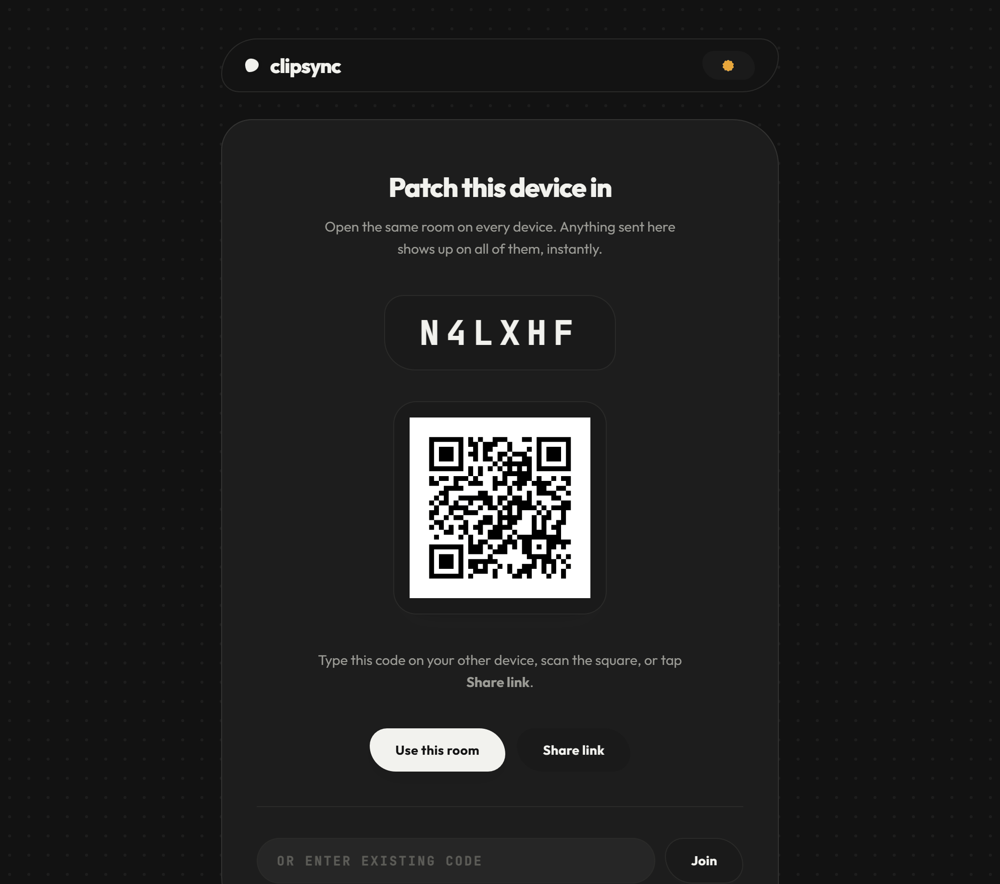

# clipsync

Move your clipboard between your own devices, in the browser. Open the same room
on your laptop and your phone, and anything you send on one appears on the other
instantly - text, links, images, files. No account, no app, no extension.

## → [Open clipsync at clipsync.swikrut.com](https://clipsync.swikrut.com)



---

## How it works

1. **Open clipsync.** It gives you a six-character room code and a QR code.
2. **Scan the QR with your other device**, or type the code into it, or send
   yourself the link.
3. **Both devices are now in the same room.** The one showing the QR follows you
   in automatically the moment the other scans it - there is nothing to press on
   the laptop.

Anything either device sends from then on shows up on both. The QR code stays
available inside the room, so adding a third device is one tap, not a re-pair.

**Sending things**

- Type in the box and hit **Send**, or `Ctrl`/`⌘ + Enter`.
- **Paste** anything into the page and it sends automatically - including
  screenshots straight from the clipboard.
- **＋ File / image** for anything up to about 4.5 MB.
- Every item gets a **Copy** button on the other device; files get **Save**.

**Add it to your home screen.** clipsync is an installable web app. On iOS use
*Share → Add to Home Screen*; on Android or desktop Chrome, use the install
button in the address bar. It then opens like any other app.

---

## What the server can see

Worth thirty seconds of your attention before you paste anything sensitive.

Every item is encrypted **in your browser** with AES-256-GCM before it is sent.
The server stores and forwards ciphertext only, so anyone watching the network,
and anyone who gets hold of the database, sees nothing but ciphertext.

**But the encryption key is derived from the room code, and the server has to
receive that code in order to route your messages between devices.** That means
whoever operates the server can derive the same key and read your items. On
`clipsync.swikrut.com`, that is me.

So clipsync protects you against network snooping and against someone walking off
with the stored data. It does **not** protect you against the operator, the way a
properly end-to-end encrypted app would. Treat it like handing a note to a friend
to pass along: safe from everyone in between, not from the friend.

This is a limitation of the design, not a bug: the room code is both the secret
and the routing address, and it has to stay short enough to read aloud. If you
want the guarantee without the trust, [run your own](#self-hosting) - it takes
about five minutes.

**Also worth knowing**

- **Anyone with the room code can read the room**, and can clear its history.
  Keep it to yourself. Codes come from a 32-character alphabet, so there are
  roughly a billion of them, and guessing is rate limited - but the code is the
  only lock on the door.
- Items stay until you clear them, or until the room sits unused for **3 days**.
- Rooms keep the **30** most recent items.
- There is no log-in, so there is nothing tying a room to you beyond the code.

---

## Self-hosting

Everything above runs on a single small Node process with one JSON file of
state - it is perfectly happy on a Raspberry Pi or a NAS. Host it yourself if you
would rather not trust someone else's server, or just want it on your own LAN.

```sh
git clone https://github.com/YOU/clipsync.git
cd clipsync
docker compose up -d
```

That gives you the container on port 4173, a `clipsync-data` named volume, a
healthcheck, and a graceful stop that flushes state to disk. Then put a
TLS-terminating proxy in front - see below, it is not optional.

### The page must end up on HTTPS

Browsers only expose the Web Crypto API - the thing that does the encryption - in
a **secure context**: an `https://` page, or `localhost`. On a page still sitting
on `http://` when it finishes loading, `crypto.subtle` does not exist at all.

What matters is where the page *lands*, not what you type. `http://your-host`
is fine as long as something upgrades it - a proxy redirect, HSTS, or the
automatic HTTPS upgrade current browsers do on their own.

| The page finishes loading on… | Works? |
| --- | --- |
| `https://clipsync.example.com` | yes |
| `http://localhost:4173` | yes - browsers trust loopback |
| `http://` that redirects or upgrades to `https://` | yes |
| `http://192.168.1.50:4173`, staying on http | **no** |

The case that actually bites is hitting the container directly on the LAN and
bypassing your proxy - `http://truenas.local:4173` stays on http. clipsync
detects that and shows a full-page explanation rather than looking healthy while
silently failing to send. Make the redirect server-side as well, so clients that
do not auto-upgrade are covered: on Cloudflare that is *SSL/TLS → Edge
Certificates → Always Use HTTPS*; in nginx, a `listen 80` block that does
`return 301 https://$host$request_uri;`.

### Reverse proxy

Anything that terminates TLS and forwards WebSockets works. Caddy needs the least
explaining, since it gets a certificate by itself:

```
clipsync.example.com {
    reverse_proxy localhost:4173
}
```

nginx needs the upgrade spelled out:

```nginx
server {
    listen 443 ssl;
    server_name clipsync.example.com;

    ssl_certificate     /etc/letsencrypt/live/clipsync.example.com/fullchain.pem;
    ssl_certificate_key /etc/letsencrypt/live/clipsync.example.com/privkey.pem;

    location / {
        proxy_pass http://127.0.0.1:4173;
        proxy_http_version 1.1;
        proxy_set_header Upgrade $http_upgrade;
        proxy_set_header Connection "upgrade";
        proxy_set_header Host $host;
        proxy_set_header X-Forwarded-For $proxy_add_x_forwarded_for;
        proxy_set_header X-Forwarded-Proto $scheme;
        client_max_body_size 16m;
        proxy_read_timeout 3600s;
    }
}
```

With Nginx Proxy Manager, enable **Websockets Support** and request a Let's
Encrypt certificate - that is the whole job.

**Set `TRUST_PROXY=1` whenever a proxy or CDN is in front.** Otherwise every
visitor arrives wearing the proxy's IP address and they all share one rate-limit
bucket, so one busy user can lock out everyone else. Leave it off when there is
no proxy: clipsync would then be trusting an `X-Forwarded-For` header any client
could forge.

If you are behind Cloudflare, use SSL mode **Full (strict)** or a Cloudflare
Tunnel. On *Flexible*, the hop from Cloudflare to your server is plain HTTP -
which puts the room code, and therefore the encryption key, on the wire in the
clear.

### TrueNAS SCALE

TrueNAS SCALE 24.10 ("Electric Eel") and later run apps on Docker, so clipsync
installs as a custom app.

**1. Make a dataset** for the data - say `tank/apps/clipsync`. This is where
`rooms.json` lives.

**2. Get the ownership right.** This is the step that bites people. TrueNAS runs
apps as uid **568** (`apps`) by default, while this image's user is uid **1000**
(`node`). If those disagree, the container cannot write its data directory. Pick
one and be consistent:

- Set the dataset's owner to `apps`/`568` and the app's *Run As* user and group
  to `568` - the TrueNAS-native way; or
- `chown -R 1000:1000 /mnt/tank/apps/clipsync` and leave the image's user alone.

clipsync checks this at startup and refuses to run if it cannot write, rather
than working fine until your first reboot and losing every room:

```
FATAL: cannot write to /app/data (EACCES)

  clipsync runs as uid 568, but that directory is owned by uid 1000
  and is not writable. Every room would be lost on the next restart, so
  clipsync is stopping instead of pretending to save them.
```

**3. Install it.** *Apps → Discover Apps → Custom App → Install via YAML*:

```yaml
services:
  clipsync:
    image: ghcr.io/YOU/clipsync:latest    # or build and push your own
    container_name: clipsync
    user: "568:568"                       # match the dataset owner from step 2
    ports:
      - "4173:4173"
    environment:
      TRUST_PROXY: "1"
    volumes:
      - /mnt/tank/apps/clipsync:/app/data
    restart: unless-stopped
```

**4. Put it behind HTTPS.** TrueNAS apps are plain HTTP by default, which
clipsync refuses to run on. Install *Nginx Proxy Manager* or *Traefik* from the
catalogue and point a hostname at `http://TRUENAS-IP:4173`, or use a Cloudflare
Tunnel and avoid opening a port.

Your existing snapshot task covers the dataset, so room history is backed up like
anything else.

### Bare Node with systemd

```ini
# /etc/systemd/system/clipsync.service
[Unit]
Description=clipsync
After=network.target

[Service]
Type=simple
User=clipsync
WorkingDirectory=/opt/clipsync
ExecStart=/usr/bin/node server.js
Environment=PORT=4173
Environment=TRUST_PROXY=1
Restart=on-failure
# The process only ever writes to ./data
ProtectSystem=strict
ReadWritePaths=/opt/clipsync/data
PrivateTmp=true
NoNewPrivileges=true

[Install]
WantedBy=multi-user.target
```

`systemctl stop` sends `SIGTERM`, which clipsync handles by flushing rooms to
disk before exiting.

### Configuration

| Variable | Default | Meaning |
| --- | --- | --- |
| `PORT` | `4173` | Port to listen on. |
| `TRUST_PROXY` | off | Set to `1` behind a reverse proxy or CDN, so `X-Forwarded-For` / `X-Forwarded-Proto` are honoured. |
| `CLIPSYNC_EPHEMERAL` | off | Set to `1` to keep rooms in memory only. Skips the writable-data-directory check; everything is lost on restart. |

Limits are constants at the top of `server.js`:

| Constant | Default | Meaning |
| --- | --- | --- |
| `MAX_ITEMS_PER_ROOM` | 30 | Items kept per room. |
| `MAX_ROOM_BYTES` | 32 MB | Ciphertext kept per room; oldest items dropped first. |
| `MAX_ROOMS` | 250 | Concurrent rooms before new ones are refused. |
| `MAX_ENC_LEN` | 10 MB | Largest single encrypted payload accepted. |
| `ROOM_TTL_MS` | 3 days | Idle time before a room is pruned. |

The browser refuses files over ~4.5 MB, which lands under `MAX_ENC_LEN` after
base64 and encryption overhead.

**One instance only.** Rooms live in the process's memory and Socket.IO has no
Redis adapter here, so two replicas behind a load balancer would not see each
other's rooms. Scale up, not out.

---

## Architecture

- `server.js` - Express for static files, Socket.IO for the relay. Holds rooms in
  memory and mirrors them to `data/rooms.json` with a coalesced, atomic
  (write-temp-then-rename) save. Flushes on `SIGTERM` / `SIGINT`.
- `public/app.js` - the whole client: pairing, crypto, rendering, clipboard.
  Anything composed while the connection is down is held in an outbox and sent
  once the room join is acknowledged, so a network blip does not silently swallow
  what you just copied.
- `public/sw.js` - service worker. Network-first for everything; it exists to make
  the app installable and render the shell offline, not to serve stale builds.
- `scripts/vendor.js` - copies Socket.IO, the QR generator and the webfonts out of
  `node_modules` into `public/vendor` at install time, so the page loads nothing
  from a CDN. A privacy tool should not leak every user's IP and room visit to a
  third party, and a compromised CDN script would see plaintext before it gets
  encrypted. Re-run with `npm run vendor` after bumping deps.

### Socket protocol

| Event | Direction | Purpose |
| --- | --- | --- |
| `join` | client to server | Enter a room. Acks with the room's items. |
| `watch` | client to server | Subscribe to *notification only* for a room code, without joining it. Used by the pairing screen so the device showing a QR can follow a scanner into the room. Watchers receive no items and are not counted in presence. |
| `unwatch` | client to server | Drop a watch subscription. |
| `push` | client to server | Send one encrypted item. |
| `clear` | client to server | Wipe the room's history for everyone. |
| `item` | server to client | A new item arrived. |
| `cleared` | server to client | History was wiped. |
| `presence` | server to client | Current member count. |
| `peer-joined` | server to client | Somebody joined a room you are *watching*. |

---

## Development

```sh
npm install                # postinstall vendors browser assets into public/vendor
npm start                  # http://localhost:4173 - localhost is a secure context
npm run vendor             # refresh public/vendor after changing deps
curl localhost:4173/healthz
```

`node_modules/`, `data/` and `public/vendor/` are all generated - none of them
belong in a commit.

Run `npm audit` before cutting a release. The relay parses untrusted websocket
frames, so a Socket.IO advisory is not a theoretical concern here.

## License

MIT - see [LICENSE](LICENSE).
